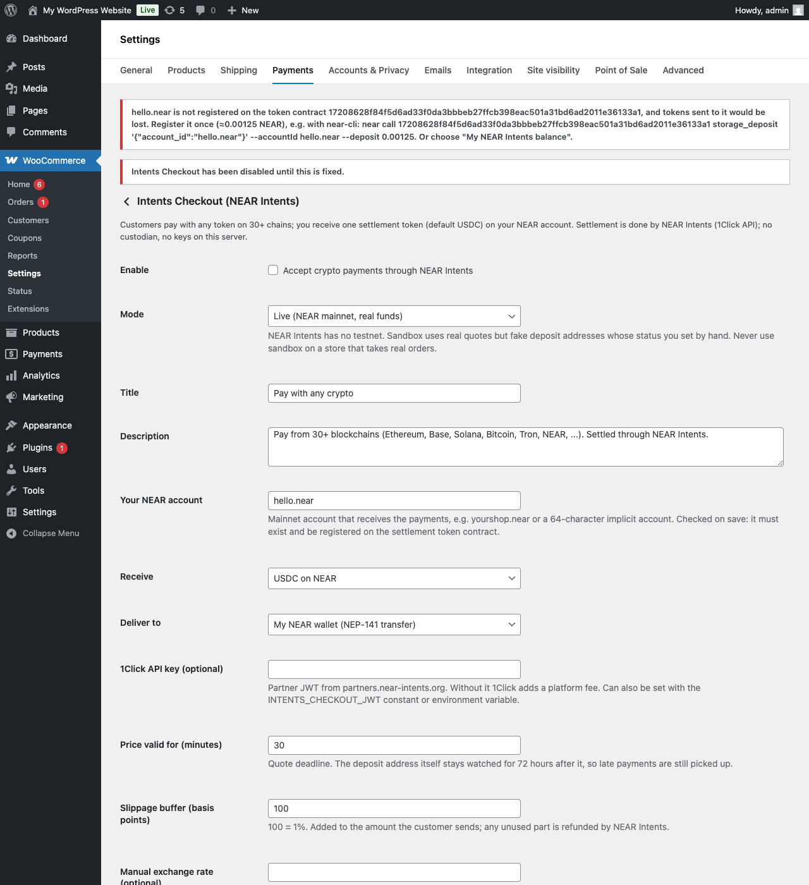
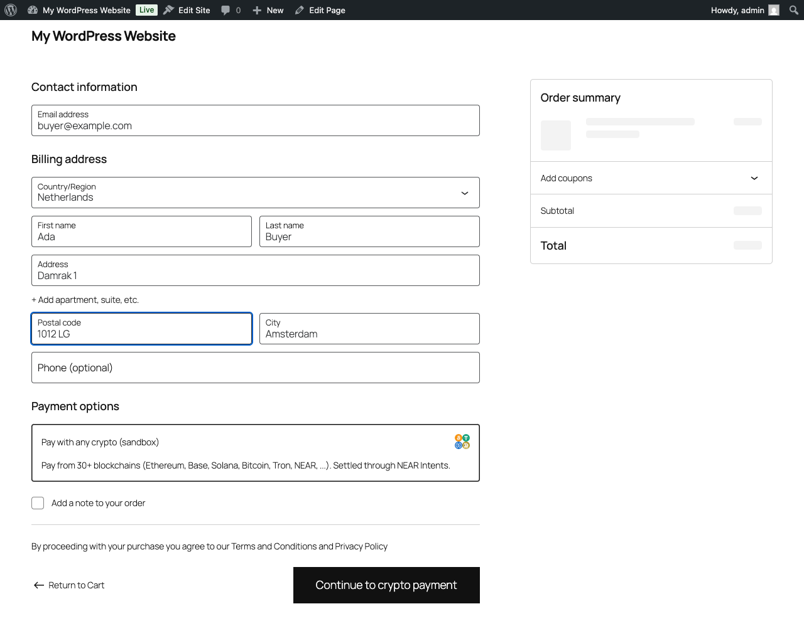
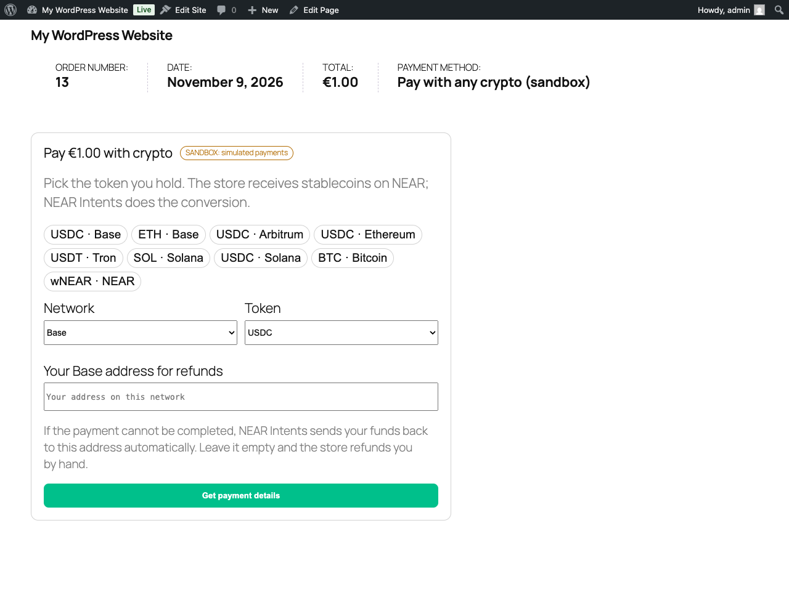
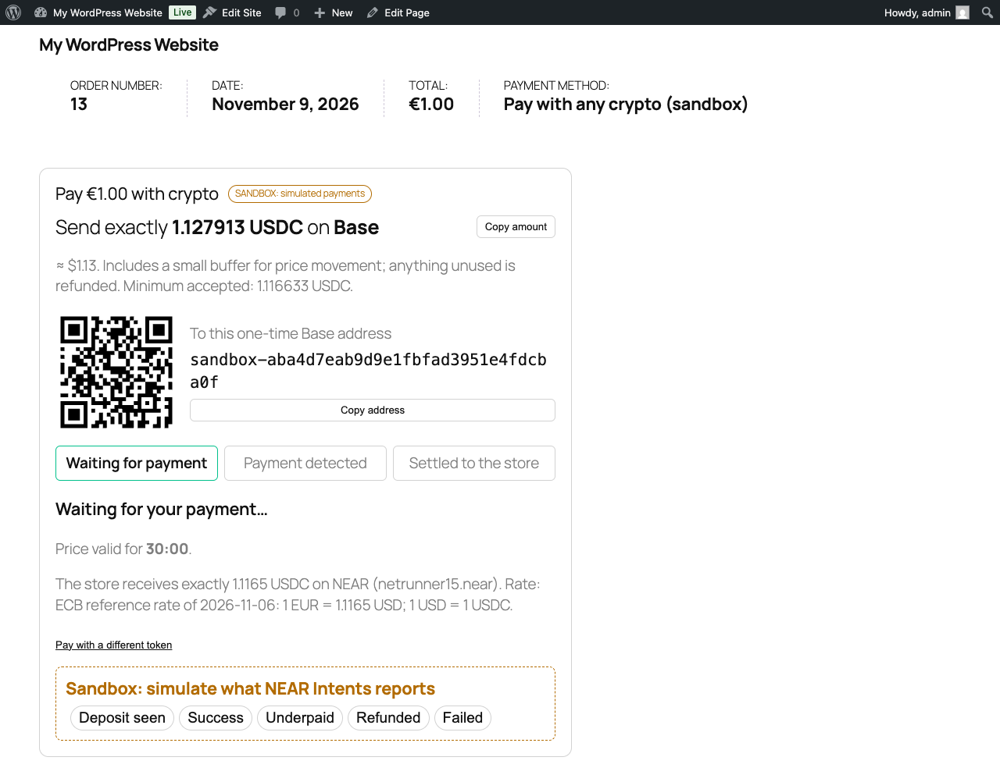
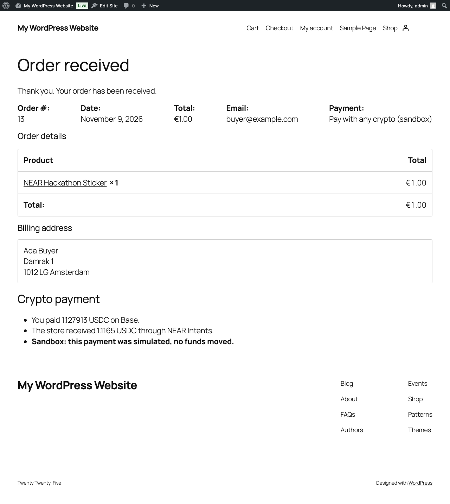

# Intents Checkout for WooCommerce

A WooCommerce payment gateway. Customers pay with **any token on 30+ chains** (ETH on Base, USDC on Arbitrum, SOL, BTC, USDT on Tron, NEAR, …) and the store receives **an exact amount of USDC on its NEAR account**. **NEAR Intents** (1Click Swap API) does the conversion and settlement. The plugin marks an order paid **only after it verifies the settlement on the server**.

Built for the [NEAR HACKATHON](https://nearhackathon.com) (1–14 Nov 2026), track **Real-World Money**.

## The problem

A shop that wants crypto payments has to choose chains, run wallets on each, and reconcile payments by hand. Its customers usually hold the "wrong" token on the "wrong" chain. Existing crypto gateways either take custody of the funds or support a few chains.

## What it does

- Adds **"Pay with any crypto"** to WooCommerce checkout (both the Checkout **block** and the **classic** shortcode checkout).
- After the order is placed, the customer picks a token. The plugin asks NEAR Intents for an `EXACT_OUTPUT` quote, so the store receives **exactly** the order total in USDC. The customer gets a one-time deposit address with a QR code, or a **"Pay with browser wallet"** button on EVM chains (MetaMask, Rabby, …).
- The server polls 1Click (there are no webhooks) and maps each state onto the WooCommerce order:

| NEAR Intents status | WooCommerce order | Customer sees |
|---|---|---|
| `PENDING_DEPOSIT` | Pending payment | amount, address, QR, countdown |
| `KNOWN_DEPOSIT_TX`, `PROCESSING` | On hold | "Payment detected, settling…" |
| `SUCCESS` **and all checks pass** | **Processing** (`payment_complete()`) | "Payment received ✓" → thank-you page |
| `SUCCESS` but a check fails | On hold + admin email | "being checked by the store" |
| `INCOMPLETE_DEPOSIT` | On hold | "received X, send the rest before …" |
| `REFUNDED` | Failed (customer can pay again) | "refunded to your address" |
| `FAILED` | On hold + admin email | "the store has been notified" |

**What "all checks pass" means** (`plugin/src/Pure/StatusEvaluator.php`):
1. The 1Click **ed25519 signature** on the quote is valid (PHP port of the SDK's `verifyQuoteSignature`, tested against real responses).
2. The signature is the same one stored on the order when the quote was created.
3. The **deposit address**, **recipient** (your NEAR account) and **settlement token** match the order.
4. The amount **actually settled** (`swapDetails.amountOut`) is at least the order amount.
5. The order isn't already paid. `payment_complete()` runs **once**, under a per-order lock.

The browser never decides that an order is paid.

**Other merchant safeguards**
- On save, the settings page checks that your NEAR account **exists** and, if you chose delivery to your NEAR wallet, that it is **registered on the USDC contract** (see [Where the money goes](#where-the-money-goes)).
- Every quote is kept on the order and watched until its deposit address expires (requested deadline + 72 h). A **late payment** to an expired or replaced quote is still detected. If an order is paid twice, the plugin tells you to refund the second payment.
- WooCommerce won't auto-cancel an unpaid order while one of its deposit addresses can still receive funds.
- Order notes record amounts, origin and settlement transaction hashes, and a NEAR Intents Explorer link.

## Where the money goes

In the settings, **Deliver to** decides where the store's USDC lands. Both options are non-custodial: only your NEAR account's keys can move the funds.

| Deliver to | What happens | Setup |
|---|---|---|
| **My NEAR wallet** | USDC arrives in your NEAR wallet like any other token (NEP-141 transfer). | Your account must be registered once on the USDC contract (0.00125 NEAR, see below). |
| **My NEAR Intents balance** | USDC is credited to your account inside NEAR Intents (`intents.near`). Keep it, swap it or withdraw it to any chain from the NEAR Intents app. | None. Also slightly cheaper: no withdrawal fee (for the same €1 order the customer sent 1.1213 instead of 1.1259 USDC in our test). |

**Why the plugin checks the wallet option.** A NEAR account must be registered on a token contract before it can hold that token. 1Click still returns a quote for delivery to an unregistered account (we tested it), but the final transfer would fail, and the 1Click API states: "No refund will be made in case of insufficient storage_deposit". So when you choose "My NEAR wallet", the settings page reads `storage_balance_of` on the USDC contract and refuses to save an unregistered account, showing the one-line fix. The NEAR Intents balance option needs no check.



## Screenshots

| Checkout block | Pick a token | Pay | Paid |
|---|---|---|---|
|  |  |  |  |

## NEAR technologies used

| Technology | How it is used |
|---|---|
| **NEAR Intents: 1Click Swap API** | `GET /v0/tokens` (asset list and prices), `POST /v0/quote` (`EXACT_OUTPUT`, `depositType: ORIGIN_CHAIN`), `GET /v0/status` (settlement polling), `POST /v0/deposit/submit` (wallet tx hash hint) |
| **1Click quote signatures** (ed25519) | Verified on the server for every quote and every status response |
| **NEAR Intents Verifier `intents.near`** | Settlement layer behind 1Click; optional "deliver to my Intents balance" mode |
| **NEAR Intents Explorer** | Links in order notes and on the pay page |
| **Chain abstraction** | The customer pays from any of the chains 1Click supports; the merchant only needs a NEAR account |
| **NEP-141** (USDC/USDT on NEAR) and **NEP-145** storage management | Settlement token; `storage_balance_of` check before going live |
| **NEAR JSON-RPC** | `view_account` to validate the merchant account |
| **NEAR named accounts** | `yourshop.near` as the payout address |

---

## Try it in 3 minutes (no crypto needed)

Requirements: Docker with Compose. Ports: 8080.

**Sandbox mode** uses real NEAR Intents prices and real quote calculations (a `dry:true` 1Click quote). The deposit address is fake, and you choose what NEAR Intents "reports". NEAR Intents has no testnet ([docs](https://docs.near-intents.org/resources/faqs)).

1. **Start the store**
   ```sh
   cp .env.example .env
   docker compose up -d
   docker compose logs -f setup      # wait for "setup done", then Ctrl+C
   ```
   → The log ends with `wp intents-checkout check` output: `1Click tokens: ~200 assets on ~39 chains`, `Exchange rate: 1.1… (ECB reference rate …)`, and `setup done -> http://localhost:8080/shop`.

2. **Open http://localhost:8080/shop**
   → One product: "NEAR Hackathon Sticker", €1.00.

3. **Add it to the cart → Checkout**, fill in any name and email, select **"Pay with any crypto (sandbox)"** → **Continue to crypto payment**.
   → The pay page shows "Pay €1.00 with crypto", quick picks (USDC · Base, ETH · Base, SOL · Solana, BTC · Bitcoin, …) and the full network and token list, loaded live from NEAR Intents.

4. **Click "USDC · Base"** → **Get payment details**.
   → "Send exactly 1.1… USDC on Base" (€1.00 converted at the ECB reference rate, plus a 1% buffer), a QR code, a `sandbox-…` address, a 30-minute countdown, and "The store receives exactly 1.1… USDC on NEAR".

5. **In the yellow sandbox box, click "Deposit seen", then "Success".**
   → Steps go Waiting → Detected → Settled. Then "Payment received ✓" and a redirect to the WooCommerce order-received page.

6. **Open http://localhost:8080/wp-admin → WooCommerce → Orders** (admin / admin).
   → The order is **Processing**. Its notes say `[SANDBOX: simulated, no funds moved]` and include the quote, the detected deposit, and "Payment settled through NEAR Intents … Verified server-side (status SUCCESS, 1Click signature, recipient, asset, amount)".

7. **Try the unhappy paths** (new order each time, or from the command line):
   ```sh
   docker compose exec cli wp intents-checkout demo-order --asset=nep141:base-0x833589fcd6edb6e08f4c7c32d4f71b54bda02913.omft.near
   docker compose exec cli wp intents-checkout simulate <order_id> INCOMPLETE_DEPOSIT   # → on-hold, "Underpaid: received …"
   docker compose exec cli wp intents-checkout simulate <order_id> REFUNDED             # → failed, "NEAR Intents refunded …"
   docker compose exec cli wp intents-checkout simulate <order_id> FAILED               # → on-hold, admin email
   ```
   → `demo-order` prints a real 1Click price for that asset. Each `simulate` prints the order status and the evaluated state.

8. **Run the unit tests**
   ```sh
   docker compose run --rm tests
   ```
   → `30 passed, 0 failed, 0 skipped`. They cover signature verification against **real** 1Click mainnet responses, tampering (swapped recipient, deposit address or amount → rejected), every status, under-settlement, wrong recipient, and decimal/FX maths.

9. **Switch to the classic checkout** and repeat steps 3–5:
   ```sh
   docker compose exec cli wp intents-checkout checkout-page classic
   ```
   → Same payment method, now in the classic shortcode checkout (`blocks` switches back).

### Verify a real mainnet payment without spending anything

```sh
docker compose exec cli wp intents-checkout replay <DEPOSIT_ADDRESS>
```
This fetches the live 1Click status of a **real past mainnet payment**, verifies its signature, creates a new order bound to it, and runs the normal verification. → The order becomes **Processing**, with the real origin and NEAR transaction hashes in the notes (tagged `[REPLAY …]`).

Real payments made while building this (live mode, guglielmoruffo.eu):

| Date | Paid | Store received | Deposit address |
|---|---|---|---|
| _to be added after the first mainnet test_ | | | |

### No Docker?

```sh
npx @wp-playground/cli@3.1.62 server --wp=6.9.4 --php=8.3 \
  --mount=./plugin:/wordpress/wp-content/plugins/intents-checkout \
  --blueprint=./playground/blueprint.json
```
→ Same store at http://127.0.0.1:9400/shop (logged in as admin), sandbox mode. Steps 2–6 work as above.

---

## Use it on a real store (live mode, mainnet)

1. Create or choose a NEAR mainnet account, e.g. `yourshop.near`, and choose where payments land ([Where the money goes](#where-the-money-goes)):
   - **My NEAR Intents balance**: nothing else to do.
   - **My NEAR wallet**: register the account on the USDC contract once (0.00125 NEAR), e.g. with near-cli:
     `near call 17208628f84f5d6ad33f0da3bbbeb27ffcb398eac501a31bd6ad2011e36133a1 storage_deposit '{"account_id":"yourshop.near"}' --accountId yourshop.near --deposit 0.00125`
2. `./bin/build-zip.sh` → upload `dist/intents-checkout.zip` under **Plugins → Add New → Upload**. Or copy `plugin/` to `wp-content/plugins/intents-checkout`.
3. **WooCommerce → Settings → Payments → Intents Checkout**: enable, Mode **Live**, your NEAR account, **Deliver to**, optionally a 1Click API key → Save.
   → "NEAR account yourshop.near checked: it exists and can receive the settlement token." A non-existent account, or an unregistered one with "My NEAR wallet", shows the exact fix and the gateway stays off.
4. Optional: **Show to: shop managers only** to test on a live store without customers seeing it.
5. Make sure WP-Cron or a system cron runs, so payments are detected when nobody has the pay page open, e.g. `* * * * * wp --path=/var/www/html action-scheduler run --group=intents-checkout`.

**Fees** (charged by NEAR Intents, not by this plugin): without an API key, 1Click adds 0.25% on non-stablecoin routes ([fees](https://docs.near-intents.org/resources/fees)). With a partner key it's 0.20%, or 0.01% on stablecoin routes. The customer also pays normal network gas.

**Currencies**: converted automatically. USD: 1 USD = 1 USDC. EUR, GBP, CHF and about 25 other currencies: the [European Central Bank daily reference rate](https://www.ecb.europa.eu/stats/policy_and_exchange_rates/euro_reference_exchange_rates/html/index.en.html), checked hourly. The rate and its source are fixed on each order when the quote is created and shown to the customer. If the ECB cannot be reached, EUR falls back to NEAR Intents' EURe price. A manual rate in the settings overrides all of this.

## How it works

```
Browser (pay page)                 WordPress (this plugin)                         NEAR Intents 1Click
pick token + refund address ──► POST /wp-json/intents-checkout/v1/orders/{id}/quote
                                   amount = order total → USDC units (FX), EXACT_OUTPUT
                                   POST /v0/quote ─────────────────────────────────► quote + deposit address + signature
                                   verify signature + fields, store on order ◄─────
show amount, address, QR ◄──────
[Pay with wallet] → ERC-20 transfer / native send on the origin chain
                ──► POST …/deposit (tx hash hint) → POST /v0/deposit/submit ───────►
poll GET …/orders/{id} ────────► OrderSync (also every 20 s via Action Scheduler)
                                   GET /v0/status ─────────────────────────────────► status + swapDetails + signed quote
                                   StatusEvaluator: signature, address, recipient, asset, amount
                                   → payment_complete() once, order notes with tx links
```

| File | Role |
|---|---|
| `plugin/src/Gateway.php` | `WC_Payment_Gateway`: settings, merchant validation, `process_payment()` → pay page |
| `plugin/src/Blocks/PaymentMethod.php`, `assets/blocks.js` | Checkout block integration (no build step) |
| `plugin/src/QuoteService.php` | Builds and checks quotes (server decides amount, recipient, token) |
| `plugin/src/OrderSync.php` | Polling, lock, idempotent completion, state → order mapping, back-off scheduling |
| `plugin/src/Pure/StatusEvaluator.php` | Pure decision logic (unit-tested) |
| `plugin/src/Pure/QuoteSignature.php` | ed25519 / base58 / stable-JSON port of the 1Click SDK verifier |
| `plugin/src/OneClick/SandboxClient.php` | Sandbox: real dry-run prices, simulated status |
| `plugin/src/Near/Rpc.php` | `view_account`, `storage_balance_of` |
| `plugin/src/Rest.php` | Pay-page API, authorised by the WooCommerce order key |
| `plugin/src/Cli.php` | `wp intents-checkout check / demo-order / status / sync / simulate / replay / checkout-page` |
| `plugin/assets/pay.js` | Pay page UI, EIP-1193 wallet payment |

## Limitations

- Wallet button: EVM chains only. Other chains use copy/QR (any wallet works).
- Refunds of *paid* orders back to the customer are not automated yet (WooCommerce refunds stay manual).
- Sandbox mode must never be enabled on a store that takes real orders: a simulated success marks the order paid. The admin shows a warning while sandbox is on.
- Not legal or tax advice: accepting crypto may have compliance obligations where you operate.

## Built with / disclosure

- All code in this repository was written during the hackathon (Nov 2026), with AI assistance (Claude Code).
- Bundled third-party code: [qrcode-generator](https://github.com/kazuhikoarase/qrcode-generator) 1.4.4 (MIT, `plugin/assets/vendor/qrcode.js`).
- Runtime: WordPress, WooCommerce (Action Scheduler), WordPress's bundled `sodium_compat` for ed25519.
- References: [NEAR Intents docs](https://docs.near-intents.org), [1Click OpenAPI](https://1click.chaindefuser.com/docs/v0/openapi.yaml), [official TS SDK](https://www.npmjs.com/package/@defuse-protocol/one-click-sdk-typescript) (signature algorithm and public key).

## License

MIT, see [LICENSE](LICENSE).
